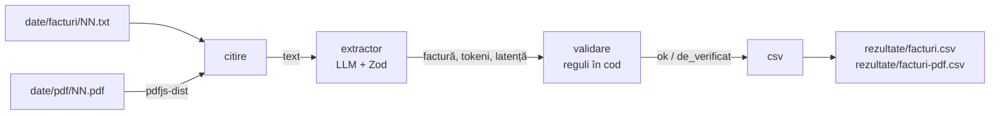

# invoice-extractor

Tema 7 — Extractor de facturi și bonuri (laburile 1-12). Nivel atins: **Avansat**.

Din text sau PDF extrage datele facturii cu un LLM, le validează cu reguli scrise în cod și le exportă în CSV. Cerințele sunt în [docs/REQUIREMENTS.md](docs/REQUIREMENTS.md); planul, deciziile și istoricul rulărilor sunt în [docs/PLAN.md](docs/PLAN.md).

## Ce face proiectul



Modelul doar extrage; codul decide dacă factura e validă.

- **Citire:** `date/facturi/NN.txt` sau, cu argumentul `pdf`, `date/pdf/NN.pdf`. Din PDF se ia textul paginii cu `pdfjs-dist`, ca în L11 (`src/citire.ts`, `src/pdf.ts`).
- **Extragere** (`src/extractor.ts`): `withStructuredOutput` cu schema Zod din `src/schema.ts`: `furnizor`, `cui`, `data`, `linii[{ produs, cantitate, pret }]`, `total`. Instrucțiunea îi cere modelului să scrie ce spune documentul, fără să corecteze sau să calculeze vreo valoare. Un răspuns care nu respectă schema este respins, nu reparat.
- **Rezervă:** `withFallbacks` trece la modelul de rezervă doar când principalul aruncă eroare (providerul a picat după reîncercări). Un răspuns sosit, dar inutilizabil, rămâne extragere eșuată. Raportul spune ce model a răspuns la fiecare factură.
- **Validare** (`src/validare.ts`):
  - factura are cel puțin o linie;
  - suma liniilor (`cantitate × pret`, rotunjit la 2 zecimale; prețurile includ TVA) este egală cu totalul, cu toleranță 0.01;
  - data e o dată reală din calendar și nu e în viitor (față de ziua rulării la `pnpm start`; eval-ul folosește data fixă 2026-11-12);
  - CUI-ul are prefix `RO` opțional, 2-10 cifre cu prima diferită de 0 și cifra de control corectă.
- **Status:** o factură care pică o regulă devine `de_verificat`, cu lista problemelor; valorile ei rămân cum le-a extras modelul. O extragere eșuată devine un rând `de_verificat` cu motivul, iar rularea continuă.
- **CSV** (`src/csv.ts`, fără bibliotecă): un rând pe linie de factură, cu câmpurile facturii repetate: `fisier, furnizor, cui, data, produs, cantitate, pret, total, status, probleme`.

Fluxul e fix, deci nu folosește agent, tool-uri sau graf. Din curs folosește:

| Ce | Lab | Pentru |
|---|---|---|
| `llm.ts`, `cost.ts` (din curs) | L1 | providerul ales din `LLM_PROVIDER`; raportul de cost |
| `withFallbacks`, eval pe un set etichetat | L2-3 | rezerva; acuratețea pe câmp |
| `RunnableLambda` | L5 | ramurile extractorului |
| `withStructuredOutput` + Zod | L6 | extragerea |
| `FakeToolCallingModel({ structuredResponse })` | L9 | testele offline |
| `pdfjs-dist`, textul paginii | L11 | intrarea PDF |

## Cum se rulează

Node 22 și pnpm.

```bash
pnpm install
cp .env.example .env    # apoi completează GOOGLE_API_KEY
pnpm start
```

`pnpm start` extrage cele 20 de facturi din `date/facturi`, le validează și scrie `rezultate/facturi.csv`. Facturile se extrag pe rând, cu o pauză de 4.5 s între facturi, aleasă ca rularea să rămână sub 15 cereri pe minut, limita gratuită Gemini presupusă în `src/extractor.ts` (nemăsurată).

| Comandă | Ce face |
|---|---|
| `pnpm start:pdf` | la fel, pe copiile PDF din `date/pdf`; scrie `rezultate/facturi-pdf.csv` |
| `pnpm eval` | setul de eval pe text; scrie `rezultate/eval.md` (acuratețe pe câmp, validare, tokeni, cost, latență) |
| `pnpm eval:pdf` | la fel, pe PDF; scrie `rezultate/eval-pdf.md` |
| `pnpm compara` | eval-ul pe PDF o dată pentru fiecare rulare a fiecărui model; salvează rulările în `rezultate/comparatie/` și scrie `rezultate/comparatie.md`. `pnpm compara <model> <n>` reface o singură rulare |
| `pnpm compara:raport` | reface `rezultate/comparatie.md` din rulările salvate, fără apeluri la model |
| `pnpm pdf` | doar pentru dezvoltare: scrie `date/pdf/NN.pdf` din `date/facturi/NN.txt` |
| `pnpm test` | testele offline, fără cheie |
| `pnpm typecheck` | `tsc --noEmit` |

## Chei de API și variabile

`.env` (ignorat de git) se încarcă doar când un fișier e rulat ca script, niciodată la import. Variabilele din `.env.example`:

| Variabilă | În `.env.example` | Rol |
|---|---|---|
| `LLM_PROVIDER` | `gemini` | providerul; se schimbă din mediu, nu din cod: `azureopenai`, `gemini`, `openai`, `anthropic`, `xai`, `ollama` |
| `GOOGLE_API_KEY` | goală | cheia Gemini, singura cheie de care are nevoie configurația din `.env.example` |
| `GEMINI_MODEL` | `gemini-3.5-flash-lite` | modelul principal |
| `LLM_FALLBACK_PROVIDER` | `gemini` | providerul rezervei; fără el nu există rezervă |
| `LLM_FALLBACK_MODEL` | `gemini-3.1-flash-lite` | modelul rezervei; setat fără `LLM_FALLBACK_PROVIDER`, sau identic cu principalul, oprește rularea |
| `COMPARA_MODELE` | comentată | pentru `pnpm compara`: `model:n,...`, modele ale providerului din `LLM_PROVIDER` și câte rulări are fiecare; lipsa = lista din `src/eval/comparatie.ts` |

Pentru alt provider, variabilele sunt la începutul `src/lib/llm.ts` (de exemplu `OPENAI_API_KEY` + `OPENAI_MODEL`, `ANTHROPIC_API_KEY` + `ANTHROPIC_MODEL`, `OLLAMA_MODEL` local, fără cheie). Cu apeluri reale a rulat doar Gemini, pe o singură cheie.

Testele nu au nevoie de cheie și nici de `.env`.

## Cât costă o rulare

Costul este calculat cu `src/lib/cost.ts`, din tokenii fiecărei facturi, la prețul de listă al nivelului plătit pentru modelul care a răspuns. Tokenii de ieșire includ tokenii de gândire. Toate rulările au fost făcute pe nivelul gratuit Gemini.

Prețuri, pe 1M tokeni (din rezultate/eval.md și rezultate/comparatie.md):

| Model | Intrare | Ieșire |
|---|---|---|
| `gemini-3.5-flash-lite` | $0.30 | $2.50 |
| `gemini-3.1-flash-lite` | $0.25 | $1.50 |
| `gemini-3-flash-preview` (rândul `gemini-3-flash`) | $0.50 | $3.00 |

| Rulare | Tokeni intrare / ieșire | Cost total | Cost pe factură extrasă | Sursa |
|---|---|---|---|---|
| `pnpm eval`, text, 20 facturi (rezerva a răspuns la 4) | 7753 / 5009 | $0.013689 | $0.000684 | rezultate/eval.md |
| `pnpm eval:pdf`, 20 facturi | 7386 / 5010 | $0.014741 | $0.000737 | rezultate/eval-pdf.md |
| `pnpm compara`, o rulare de 20 de facturi | vezi comparația | între $0.007952 și $0.049389 | între $0.000461 și $0.003293 | rezultate/comparatie.md |

O factură eșuată nu are tokeni, deci costul total al unei rulări scade cu extragerile eșuate. `pnpm start` face aceleași extrageri ca `pnpm eval` pe același set, deci costul lui ar trebui să fie de același ordin (deducție: `pnpm start` afișează tokenii fiecărei facturi, dar nu scrie un raport de cost).

## Nivel atins: Avansat

| Nivel | Cerința | Ce s-a făcut | Tag |
|---|---|---|---|
| Minim | facturi sintetice ca text; schemă Zod (furnizor, CUI, dată, linii, total); 15 facturi; eval pe câmpuri; CSV scris din cod | 20 de facturi și bonuri text (15 corecte, 5 cu greșeli plantate); schema din `src/schema.ts`; eval câmp cu câmp față de `date/asteptat/NN.json`; CSV scris de `src/csv.ts` | `minim` |
| Bun | validare în cod: sumă, dată, format CUI; facturile greșite marcate, nu corectate; fallback cu `withFallbacks` | regulile de mai sus, plus cifra de control a CUI-ului; `de_verificat` cu motivul, valorile neschimbate; principal `gemini-3.5-flash-lite`, rezervă `gemini-3.1-flash-lite` | `bun` |
| Avansat | PDF citit cu `pdfjs-dist` (textul paginii, ca în L11); comparație între 2-3 provideri: acuratețe pe câmp, cost, latență | `pnpm eval:pdf` și `pnpm start:pdf` pe copiile PDF; `pnpm compara`: 3 modele Gemini pe setul PDF, cu acuratețe pe câmp, cost și latență | `avansat` |

**Abatere la Avansat:** comparația este între modele ale aceluiași provider (Gemini), nu între provideri, pentru că exista o singură cheie (decizie notată în docs/PLAN.md §6).

Tag-urile `minim` și `bun` sunt pe același commit, al feliei 5: primul al cărui CSV conține toate facturile. `avansat` este pe commitul feliei 7 (docs/PLAN.md §5).

Cerințele comune:

1. README: acest fișier.
2. `llm.ts` comutabil: providerul vine din `LLM_PROVIDER`, rezerva din `LLM_FALLBACK_PROVIDER`.
3. Test offline cu model fals: vezi [Teste](#teste).
4. Set de eval de cel puțin 15 exemple: 20 de facturi, cu valorile reale în `date/asteptat/` și codurile de validare așteptate în `date/asteptat-validare.json`.
5. Raport de cost calculat cu `cost.ts`: secțiunea „Tokeni, cost si latenta” din `rezultate/eval.md` și `rezultate/eval-pdf.md`.
6. Date sintetice: vezi [Pregătirea datelor](#pregătirea-datelor-doar-pentru-dezvoltare).
7. `tsc --noEmit` trece (`pnpm typecheck`).

## Rezultatele eval

Un control e corect când valoarea extrasă este egală cu cea reală după normalizare (litere mari/mici și spații la text, prefixul `RO` la CUI, 0.01 la sume). `linii` verifică numărul de linii. Rapoartele din `rezultate/` sunt mereu ultima rulare, nu cea mai bună.

### Text (rularea 5) și PDF (rularea 6)

| Măsură | Text, 2026-11-12 | PDF, 2026-11-19 |
|---|---|---|
| `furnizor`, `cui`, `total`, `linii` | 20/20 fiecare | 20/20 fiecare |
| `data` | 20/20 | 19/20 |
| `produs`, `cantitate`, `pret` | 78/78 fiecare | 78/78 fiecare |
| Controale corecte | 334/334 (100.0%) | 333/334 (99.7%) |
| Facturi complet corecte | 20/20 | 19/20 |
| Extrageri eșuate | 0/20 | 0/20 |
| Greșite semnalate | 5/5 | 4/5 |
| Corecte lăsate `ok` | 15/15 | 15/15 |
| Facturi cu exact codurile așteptate | 20/20 | 19/20 |
| Răspunsuri de la rezervă | 4/20 | 0/20 |
| Latență medie / maximă | 11880 / 87778 ms | 21671 / 295956 ms |
| Cost | $0.013689 | $0.014741 |

(din rezultate/eval.md și rezultate/eval-pdf.md)

Pe PDF, singura greșeală: la `17.pdf` modelul a întors data imposibilă 31.02.2026 ca `2026-02-28` (așteptat `2026-02-31`), deci factura a trecut nesemnalată. Latența maximă e a lui `20.pdf` (apeluri lente, fără timeout pe cerere).

`pnpm start` și `pnpm start:pdf` au semnalat fiecare cele 5 facturi greșite (16-20), cu motivele așteptate, și au lăsat `ok` celelalte 15 (din rezultate/facturi.csv și rezultate/facturi-pdf.csv). La `pnpm start:pdf` a răspuns rezerva pentru `17.pdf` și a păstrat data 31.02 (docs/PLAN.md §6).

### Comparația între modele

Setul PDF (20 de facturi, 334 de controale pe rulare), 2026-11-19. Fiecare model are extractorul lui, fără rezervă, cu `maxRetries` 2 și 4500 ms între apeluri.

| Rulare (început, UTC) | Facturi extrase | Controale corecte, pe extrase | Extrageri eșuate | Tokeni ieșire pe factură | Cost pe factură extrasă | Latență mediană |
|---|---|---|---|---|---|---|
| `gemini-3.5-flash-lite` #1 (15:42) | 16/20 | 269/269 | 4 × 503 | 254 | $0.000752 | 60.0 s |
| `gemini-3.5-flash-lite` #2 (16:56) | 18/20 | 300/300 | 2 × 503 | 251 | $0.000739 | 10.9 s |
| `gemini-3.1-flash-lite` #1 (16:10) | 17/20 | 289/289 | 3 × 503 | 252 | $0.000468 | 7.2 s |
| `gemini-3.1-flash-lite` #2 (17:06) | 20/20 | 334/334 | 0 | 246 | $0.000461 | 19.1 s |
| `gemini-3-flash-preview` #1 (16:24) | 15/20 | 249/249 | 1 × 503, 4 × 429 | 1036 | $0.003293 | 31.2 s |

(din rezultate/comparatie.md; detaliile pe factură sunt în rezultate/comparatie/*.json)

**Constatare:** în fiecare rulare, fiecare factură extrasă a fost complet corectă și validarea a dat exact codurile așteptate. Diferențele de controale corecte dintre rulări vin numai din extragerile eșuate (10 × 503, 4 × 429). `17.pdf` și-a păstrat data 31.02 în toate cele 4 rulări care l-au extras (docs/PLAN.md §6). Pe acest set acuratețea nu separă modelele. Costul pe factură le separă (stabil între rulări). Latența și erorile 503 variază între rulările aceluiași model cât între modele, deci nu le separă; preview-ul are în plus limita de 20 de cereri pe zi.

Limite:

- Sunt modele ale unui singur provider (Gemini), nu provideri diferiți.
- Pe o rulare de 20 de facturi, diferențele mici nu sunt concludente. O singură factură mută validarea cu 20.0% (din cele 5 greșite) sau cu 6.7% (din cele 15 corecte). Același model a avut latența mediană 60.0 s și 10.9 s în două rulări; latența depinde de ora rulării și include reîncercările. `gemini-3-flash-preview` are o singură rulare, deci variația lui nu se vede.
- Extragerile eșuate arată cât de disponibil a fost modelul la ora rulării, nu cât de bine extrage.
- `gemini-3-flash-preview` este un model care gândește, iar tokenii de gândire se facturează ca ieșire: 1036 de tokeni de ieșire pe factură, față de 246-254 la celelalte. Cu prețul de listă dublu și de aproximativ 4 ori mai mulți tokeni de ieșire pe factură, costă pe factură cam de 7 ori cât `gemini-3.1-flash-lite`, fără câștig de acuratețe aici (docs/PLAN.md §6).
- Limita lui de 20 de cereri pe zi a fost atinsă la factura 17 (cele 4 × 429). Că s-a ajuns la ea prin reîncercări este o deducție din numărători, neconfirmată.

### Istoricul rulărilor eval

| Rulare | Set | Extrase | Controale corecte | Notă |
|---|---|---|---|---|
| 1 | 15, text | 15 | 255/255 | |
| 2 | 15, text | 15 | 254/255 | `14.txt`: totalul `1.089,05` citit ca 1.08905 |
| 3 | 15, text | 13 | 217/255 | 2 facturi pierdute la 503; aceeași greșeală la `14.txt` |
| 4 | 20, text | 17 | 283/334 | 3 pierdute la 503, cu cota zilnică a rezervei epuizată; toate cele 17 complet corecte |
| 5 | 20, text | 20 | 334/334 | rezerva a răspuns la 4; validarea 5/5, 15/15, 20/20; cost $0.0137 |
| 6 | 20, PDF | 20 | 333/334 | `17.pdf`: data 31.02.2026 întoarsă ca `2026-02-28`, deci validarea 4/5; totalul de la `14` citit corect; `20.pdf` a durat 296 s (apeluri lente, fără timeout pe cerere); cost $0.0147 |

(din docs/PLAN.md §6; rularea 5 este rezultate/eval.md, rularea 6 este rezultate/eval-pdf.md)

## Ce n-a mers și ce aș face diferit

Nivelul gratuit Gemini mi-a dat cele mai multe probleme: erorile 503 și cotele zilnice m-au costat două rulări eval (în rularea 3 am pierdut 2 facturi, în rularea 4 trei, cu cota zilnică a rezervei epuizată), iar în comparație limita de 20 de cereri pe zi a lui `gemini-3-flash-preview` a făcut să pice cu 429 ultimele 4 facturi ale rulării lui, de la factura 17. Pe text, singura valoare greșită pe o factură extrasă a fost totalul `1.089,05` din `14.txt`, citit ca 1.08905 în 2 din cele 5 rulări; regula sumei semnalează exact această greșeală. Mai grav, într-o rulare PDF modelul a transformat data imposibilă 31.02.2026 în 2026-02-28, deși instrucțiunea îi cere să nu corecteze nimic; nicio regulă pe dată nu poate prinde asta, pentru că rezultatul e o dată reală, așa că factura a trecut nesemnalată. O vreme, eroarea rezervei a stat ascunsă în spatele celei a principalului, pentru că `withFallbacks` aruncă doar prima eroare, până când extractorul a început să noteze eroarea fiecărui model. Scorul perfect pe text curat spune puțin: setul e ușor pentru model, iar facturile greșite și textul din PDF sunt cele care îl pun la încercare; în plus, textul din PDF pierde indentarea și spațiile repetate. Ce aș face diferit: un set de eval mai greu, cu mai multe sume cu separator de mii și mai multe date imposibile; aș măsura înainte și după o linie în instrucțiune despre formatul românesc al numerelor, pe care n-am implementat-o, deci nu știu dacă ajută; aș folosi o a doua cheie, de la alt provider, pentru o comparație reală între provideri și pentru o rezervă care chiar schimbă providerul; aș repeta rulările pentru fiecare model, ca diferențele să se poată separa de variația dintre rulări; și aș pune un timeout pe cerere, ca un apel lent să nu țină minute întregi (`20.pdf` a durat 296 s).

## Ce aș adăuga după L13-L18 (neimplementat)

- O coadă de verificare umană pentru facturile `de_verificat`, cu o pauză în flux până decide omul (L13).
- Trasarea apelurilor (tracing) și urmărirea eval-urilor în LangSmith (L18).

## Pregătirea datelor (doar pentru dezvoltare)

- Datele sunt sintetice: 15 facturi și bonuri corecte, în așezări variate, și 5 cu greșeli plantate: sumă diferită (`16`), dată imposibilă (`17`), cifră de control CUI greșită (`18`), CUI în format greșit (`19`), sumă diferită și dată în viitor (`20`). Valorile așteptate (`date/asteptat/NN.json`) notează ce scrie documentul, cu greșeli cu tot.
- PDF-urile sunt generate de `pnpm pdf` (`src/genereaza-pdf.ts`) din fișierele text, cu `pdfkit`, o devDependency din afara cursului, folosită doar la pregătirea datelor. Aplicația citește PDF-urile numai cu `pdfjs-dist`.
- Fontul încorporat este Liberation Sans, din `pdfjs-dist/standard_fonts`; licența lui (GPLv2 cu o excepție pentru fonturi) permite încorporarea. Are diacriticele românești, pe care fonturile standard ale PDF-ului nu le pot desena.
- Nu există PDF-uri scanate: ar cere OCR, care nu face parte din curs.
- Textul citit din PDF are aceleași rânduri și cuvinte ca fișierul text, dar fără indentare și cu spațiile repetate comprimate.
- Un test regenerează PDF-urile și compară octeții, deci un fișier text modificat fără `pnpm pdf` pică testele.

## Teste

`pnpm test` rulează offline: fără cheie, fără `.env`, fără rețea. În locul modelului, testele folosesc `FakeToolCallingModel` din `langchain` (`tests/modele-false.ts`), cu `structuredResponse`, sau o variantă care aruncă eroare ca un provider picat. Modelul fals întoarce mereu același răspuns, deci testele verifică codul din jurul modelului: regulile, rezerva (principalul aruncă, rezerva răspunde), parsarea, CSV-ul, eval-ul și rapoartele, `llm.ts` și `cost.ts`, citirea PDF. Nu verifică calitatea modelului.

La scrierea acestui README, `pnpm test`: 18 fișiere de test, 363 de teste trecute; `pnpm typecheck`: fără erori.
