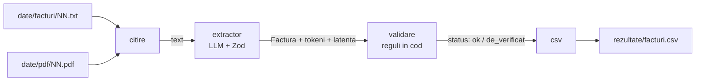
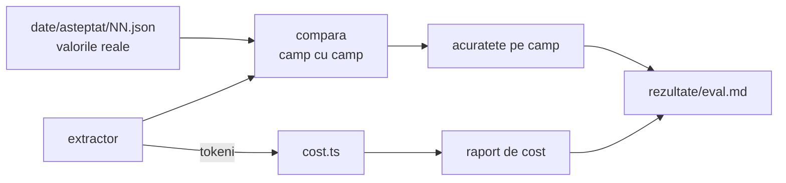
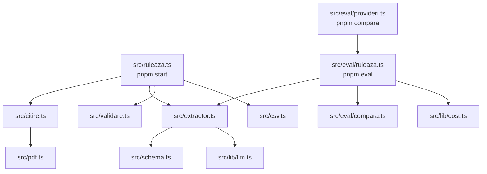
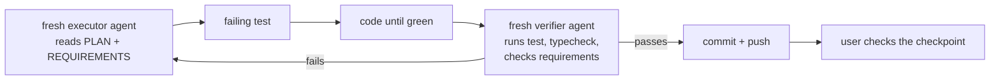

# Plan — invoice-extractor (Tema 7)

Target level: **Avansat**, reached through checkpoints at Minim and Bun.
Requirements: [REQUIREMENTS.md](REQUIREMENTS.md). This file is the single living plan: edit it in place, keep the status table current.

## 1. What the app does

The model only extracts. The code decides whether the invoice is valid. An invoice that fails a rule is marked `de_verificat` with the reason; its values are never changed.

## 2. Technical rules

Only what labs 1-12 covered, and only what this exercise needs.

| Used | Lab | For |
|---|---|---|
| `llm.ts`, `cost.ts` (copied from the course) | L1 | provider chosen by `LLM_PROVIDER`; cost report |
| `withStructuredOutput` + Zod | L6 | extraction |
| `RunnableLambda`, `.pipe` | L5 | joining steps |
| `withFallbacks` | L2-3 | provider fallback |
| Eval on a labelled dataset | L2-3 | accuracy per field |
| `FakeToolCallingModel({ structuredResponse })` | L9 | offline tests |
| `pdfjs-dist`, page text | L11 | PDF input |

**Not used:** `createAgent`, tools, middleware, `StateGraph`, Store, embeddings, checkpointer, LangSmith, Next.js UI, LLM-as-judge, CSV libraries. The flow is fixed, so it needs no agent and no graph.

### Stack

| Package | Version |
|---|---|
| `langchain` | ^1.6.5 |
| `@langchain/core` | ^1.4.0 |
| `@langchain/langgraph` | ^1.7.3 (dependency of `langchain`; no graph code is written) |
| `@langchain/google-genai` / `openai` / `anthropic` / `ollama` | ^2.3.6 / ^1.8.4 / ^1.6.4 / ^1.3.0 |
| `zod` | ^4.6.7 |
| `dotenv` | latest |
| `pdfjs-dist` | ^6.5.438 (slice 6) |
| `vitest`, `tsx`, `typescript` | ^5.1.0, latest, ^5.6 (the course major, not 7) |

Node 22, pnpm, ESM.

### Two library facts the design depends on

- `model.withFallbacks()` returns a plain runnable without `withStructuredOutput`. Order is therefore
  `principal.withStructuredOutput(schema).withFallbacks([rezerva.withStructuredOutput(schema)])`.
- `FakeToolCallingModel.withStructuredOutput()` returns `structuredResponse` unchanged and ignores options. The extractor calls `withStructuredOutput(schema, { includeRaw: true })` and reads tokens from `raw.usage_metadata`; tests give the fake a `{ raw, parsed }` object.

### Code conventions (same as `middleware-homework-1`)

- Romanian identifiers and comments, no diacritics in code. English commit messages.
- ESM imports with `.js` suffix, TypeScript `strict`.
- Tests in `tests/`, mirroring `src/`.
- Every runnable script starts with a header comment (`Rulare: pnpm ...`) and exports `ruleaza(...)`, so the test calls the same function as the command.
- Results that the README quotes are files written by a command and committed (`rezultate/`).
- Comments: 1-3 lines, the rule only.

## 3. Modules

| Command | Does |
|---|---|
| `pnpm start` | reads `date/`, extracts, validates, writes `rezultate/facturi.csv` |
| `pnpm eval` | runs the eval set, writes `rezultate/eval.md` (accuracy + tokens + cost + latency) |
| `pnpm compara` | same eval on 2-3 providers, writes `rezultate/comparatie.md` |
| `pnpm test` | offline tests, no API key |
| `pnpm typecheck` | `tsc --noEmit` |

## 4. Business rules

- **Schema:** `furnizor`, `cui`, `data`, `linii[{ produs, cantitate, pret }]`, `total`. Zod stays permissive (plain `z.string()` / `z.number()`), so a bad value reaches the validator instead of failing the parse.
- **Sum:** prices include VAT; each line value is `cantitate × pret` rounded to 2 decimals, and their sum equals `total` within 0.01.
- **Date:** output as `YYYY-MM-DD`; must be a real calendar date and not in the future.
- **CUI:** optional `RO` prefix, 2-10 digits with the first not `0` (`00`, `0000000019` are `cui_format`), valid control digit (key `753217532`).
- **Fallback:** the reserve model answers only when the primary throws (provider error after its retries); a response that arrives but is unusable (`parsed` null or outside the schema) stays an extraction failure and is not sent to the reserve. Each invoice is priced with the row of the model that answered it.
- **Status:** `ok` or `de_verificat`, plus a `probleme` list naming each failed rule.
- **CSV:** one row per line item, invoice fields repeated: `fisier, furnizor, cui, data, produs, cantitate, pret, total, status, probleme`. Fields containing `,` `"` or a newline are quoted, `"` doubled.
- **Data:** 15 correct synthetic invoices and receipts in varied layouts, plus 5 with a planted fault (wrong sum, impossible date, bad CUI). Expected values record what the document says, faults included.
- **Files:** invoices are named with zero-padded numbers (`01.txt` ... `20.txt`); the same number names the expected values and the PDF.
- **Failures:** `pnpm start` continues past a failed extraction: that invoice gets one CSV row with only `fisier`, status `de_verificat` and `extragere esuata: <first line of the error>` in `probleme`. `pnpm eval` records the failure, counts every field of that invoice as wrong, and continues.
- **Eval:** a field is correct when it equals the expected value after normalisation (case and spaces for text, `RO` prefix for CUI, 0.01 for amounts). Reported: accuracy per field, invoices fully correct, and whether the flagged set equals the expected flagged set.

## 5. Slices

Each slice is test-first and ends in a command that shows the result.

| # | Slice | Checkpoint | Status |
|---|---|---|---|
| 0 | Skeleton: `package.json`, tsconfig, `llm.ts`, `cost.ts`, `.env.example` | `pnpm typecheck` and `pnpm test` green | done |
| 1 | One text invoice → extractor → one CSV row | offline test with the fake model; `pnpm start` on one invoice with Gemini | done |
| 2 | 15 invoices + expected values + compare | `pnpm eval` prints accuracy per field | done |
| 3 | Tokens, cost, latency in the eval report | `rezultate/eval.md` has the cost table | done |
| | **Minim** — tag `minim`, set at the slice 5 commit: the first one whose CSV holds every invoice | | reached |
| 4 | Validation rules, `de_verificat`, 5 faulty invoices, `pnpm start` continues past a failed extraction | rule tests, offline only (live runs wait for slice 5) | done |
| 5 | `withFallbacks` (primary `gemini-3.5-flash-lite`, reserve `gemini-3.1-flash-lite`), answering model per invoice in the report | offline test: primary throws, reserve answers; then live `pnpm eval` and `pnpm start` on all 20 | done |
| | **Bun** — tag `bun`, same commit | | reached |
| 6 | PDF input with `pdfjs-dist` | eval on the PDF copies | todo |
| 7 | Comparison on 2-3 providers | `rezultate/comparatie.md`: accuracy per field, cost, latency | todo |
| | **Avansat** — tag `avansat` | | |
| 8 | Final README | level reached, eval results, cost, what did not work, what to add after L13-18 | todo |

### How a slice is run

The executor reports the red → green sequence and the pass count. The verifier is always a different agent from the executor.

### Rules for slice agents

Executor:
- Do only the slice in the brief. If the brief is ambiguous or cannot be done as written, stop and report.
- Test-first: write the failing test, run it and record the failure, then write code until green.
- Tests run offline: no API key, no `.env`, no network. `dotenv` is loaded only when a file is run as a script, never on import.
- Never print, edit or commit `.env`. Live model calls only where the brief asks, within its call budget, one at a time.
- Library behaviour is checked in `node_modules` source, not recalled from memory.
- No `git add`, `commit` or `push`. Leave changes in the working tree.
- Report: files changed, red → green summary lines with pass counts, outputs of the acceptance commands, deviations.

Both:
- Never print or assert on the whole `process.env` (a failing assertion dumps every shell secret into the output). Check named variables only, or hashes.

Verifier:
- Read-only on the repo; mutations are tried on a scratch copy only.
- Runs every acceptance command itself, checks each test fails when its behaviour is broken, checks the slice against `REQUIREMENTS.md` and this plan, and reports PASS / FAIL with file:line evidence.

## 6. State and next steps

Slices 0-5 are done, independently verified and pushed. Levels **Minim** and **Bun** are met. Left: slice 6 (PDF), slice 7 (comparison), slice 8 (README).

### To resume

1. Read this file and [REQUIREMENTS.md](REQUIREMENTS.md).
2. `pnpm install`, `pnpm typecheck`, `pnpm test` (offline, no key).
3. `.env` (git-ignored) holds the Gemini key, the primary model and the reserve. `.env.example` lists the variables.
4. Run the next slice as section 5 describes: one executor, a different agent to verify, commit and push on a PASS.

### Decisions needed before the next slices

- **Slice 6, where the PDFs come from.** Default unless the owner says otherwise: a dev-only script writes `date/pdf/NN.pdf` from the same 20 synthetic invoices with `pdfkit` (a devDependency outside the course, used for data preparation only and named as such in the README). The owner may also supply a few fake, text-based PDFs as an extra test; scans need OCR, which is outside the course.
- **Slice 7, which providers.** Only a Gemini key exists and Ollama is not installed. Either the owner adds a second provider (a key, or Ollama) for a true provider comparison, or the comparison covers Gemini models only and the README says so.
- **Prompt line on Romanian number format.** Candidate fix for the `14.txt` misread below. Measure before and after; do not assume.

### What slice 6 has to change

- `src/citire.ts` reads only `.txt`; `src/eval/ruleaza.ts` maps `NN.txt` to `NN.json` with a `.txt` regex; `tests/date.test.ts` hard-codes 20 files.
- `date/asteptat-validare.json` is keyed by number (`"01"`), so the same key already names the PDF.
- `pdfjs-dist` ^6.5.438 is not installed yet. Use the page text, not the book extractor from L11.

### What slice 7 has to respect

- Build each extractor directly with `creeazaExtractor(model, nume)`: no reserve, and the same `maxRetries` for every provider, so each number is that provider's own.
- The latency figure wraps the whole call, including retries. With the default 6 retries one 503 adds 1-2 minutes.
- One run cannot separate two models that differ by a single check (see the run history). Run each at least twice if the quota allows.
- A model with no row in `cost.ts` is reported as "pret necunoscut", never as free. Ollama has no row.

### Gemini free tier, as observed on 2026-11-12

| Model | Observed |
|---|---|
| `gemini-3.5-flash-lite` (primary) | about 140 calls in the day with no quota error; 503 "high demand" after retries during a few hours of the afternoon |
| `gemini-3.1-flash-lite` (reserve) | answered every time it was called; has its own price row |
| `gemini-3-flash-preview` | hard limit of 20 requests per day (429 `GenerateRequestsPerDayPerProjectPerModel-FreeTier`); a thinking model |
| `gemini-3.6-flash` | timed out |
| `gemini-flash-latest` | 503 |
| `gemini-2.5-flash` | 404, closed to new users |

A 20-invoice run on a 20-per-day model uses that model's whole day.

### Library facts the code depends on

- `model.withFallbacks()` returns a plain runnable, so structured output is attached to each model first and the fallback joins the branches. When every branch throws, the library rethrows only the first error; `src/extractor.ts` records each branch's error so the failure names every model.
- `withStructuredOutput(schema, { includeRaw: true })` turns a parse failure into `parsed: null` instead of throwing. The extractor checks for it and re-validates with the schema.
- `@langchain/google-genai` puts only answer tokens in `output_tokens`; thinking tokens are `total_tokens − input_tokens − output_tokens` and Google bills them as output. The extractor counts them into `iesire`.
- Chat models retry 6 times by default with exponential backoff; quota errors (429) and most 4xx are not retried. With a reserve configured the primary retries once and the reserve twice.
- `FakeToolCallingModel.withStructuredOutput()` returns `structuredResponse` unchanged and ignores its options, so tests pass `{ raw, parsed }` and cannot see the prompt or the options.

### Eval run history (for the README)

The committed report is always the latest run, never the best one.

| Run | Set | Extracted | Checks correct | Note |
|---|---|---|---|---|
| 1 | 15 | 15 | 255 / 255 | |
| 2 | 15 | 15 | 254 / 255 | `14.txt`: total `1.089,05` read as 1.08905 |
| 3 | 15 | 13 | 217 / 255 | two invoices lost to 503; same `14.txt` misread |
| 4 | 20 | 17 | 283 / 334 | three lost to 503 with the reserve's daily quota exhausted; all 17 fully correct |
| 5 | 20 | 20 | 334 / 334 | reserve answered 4; validation 5/5, 15/15, 20/20; cost $0.0137 at list price |

Across the five runs the only wrong value on an extracted invoice is the `14.txt` total, in 2 runs of 5. The sum rule flags exactly that misread. No temperature is set in the course `llm.ts`. On clean text the set is easy for the model; the faulty invoices and the PDF text are where it is tested harder.

### Left as is, on purpose

- No request timeout is set, so one slow call can take over a minute.
- `model` and `maxRetries` overrides are tested for gemini, openai, anthropic and ollama, not for xai and azure.
- The ".env is not loaded on import" tests watch `dotenv/config` only, not other ways of loading env files.
- The demonstrated fallback is Gemini to Gemini on one key. The mechanism switches provider through `LLM_FALLBACK_PROVIDER`; a second provider would make the demonstration real.

### Inputs for the final README (slice 8)

- **What did not work:** provider 503s and the 20-per-day free-tier limit cost two live runs; the thousands separator misread; the reserve's error was hidden behind the primary's until the extractor recorded both; a perfect score on clean text says little.
- **What to add after L13-18, not implemented:** a human review queue for `de_verificat` invoices with a pause in the flow (L13); tracing and eval tracking in LangSmith (L18).
