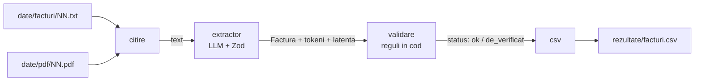
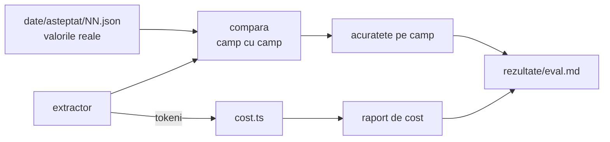
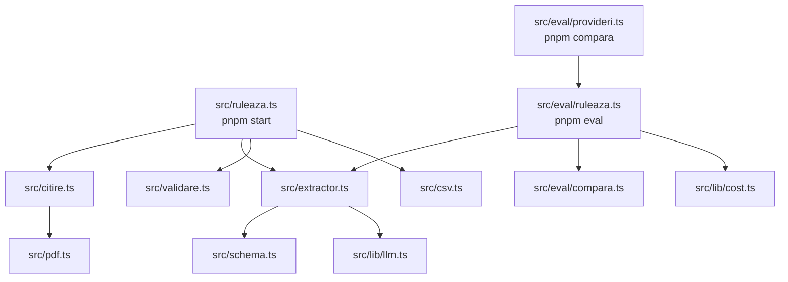
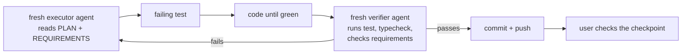

# Plan — invoice-extractor (Tema 7)

Target level: **Avansat**, reached through checkpoints at Minim and Bun.
Requirements: [REQUIREMENTS.md](REQUIREMENTS.md). This file is the single living plan: edit it in place, keep the status table current.

## 1. What the app does

The model only extracts. The code decides whether the invoice is valid. An invoice that fails a rule is marked `de_verificat` with the reason; its values are never changed.

## 2. Technical rules

Only what labs 1-12 covered, and only what this exercise needs.

| Used | Lab | For |
|---|---|---|
| `llm.ts`, `cost.ts` (copied from the course) | L1 | provider chosen by `LLM_PROVIDER`; cost report |
| `withStructuredOutput` + Zod | L6 | extraction |
| `RunnableLambda`, `.pipe` | L5 | joining steps |
| `withFallbacks` | L2-3 | provider fallback |
| Eval on a labelled dataset | L2-3 | accuracy per field |
| `FakeToolCallingModel({ structuredResponse })` | L9 | offline tests |
| `pdfjs-dist`, page text | L11 | PDF input |

**Not used:** `createAgent`, tools, middleware, `StateGraph`, Store, embeddings, checkpointer, LangSmith, Next.js UI, LLM-as-judge, CSV libraries. The flow is fixed, so it needs no agent and no graph.

### Stack

| Package | Version |
|---|---|
| `langchain` | ^1.6.5 |
| `@langchain/core` | ^1.4.0 |
| `@langchain/langgraph` | ^1.7.3 (dependency of `langchain`; no graph code is written) |
| `@langchain/google-genai` / `openai` / `anthropic` / `ollama` | ^2.3.6 / ^1.8.4 / ^1.6.4 / ^1.3.0 |
| `zod` | ^4.6.7 |
| `dotenv` | latest |
| `pdfjs-dist` | ^6.5.438 (slice 6) |
| `vitest`, `tsx`, `typescript` | ^5.1.0, latest, ^5.6 (the course major, not 7) |

Node 22, pnpm, ESM.

### Two library facts the design depends on

- `model.withFallbacks()` returns a plain runnable without `withStructuredOutput`. Order is therefore
  `principal.withStructuredOutput(schema).withFallbacks([rezerva.withStructuredOutput(schema)])`.
- `FakeToolCallingModel.withStructuredOutput()` returns `structuredResponse` unchanged and ignores options. The extractor calls `withStructuredOutput(schema, { includeRaw: true })` and reads tokens from `raw.usage_metadata`; tests give the fake a `{ raw, parsed }` object.

### Code conventions (same as `middleware-homework-1`)

- Romanian identifiers and comments, no diacritics in code. English commit messages.
- ESM imports with `.js` suffix, TypeScript `strict`.
- Tests in `tests/`, mirroring `src/`.
- Every runnable script starts with a header comment (`Rulare: pnpm ...`) and exports `ruleaza(...)`, so the test calls the same function as the command.
- Results that the README quotes are files written by a command and committed (`rezultate/`).
- Comments: 1-3 lines, the rule only.

## 3. Modules

| Command | Does |
|---|---|
| `pnpm start` | reads `date/`, extracts, validates, writes `rezultate/facturi.csv` |
| `pnpm eval` | runs the eval set, writes `rezultate/eval.md` (accuracy + tokens + cost + latency) |
| `pnpm compara` | same eval on 2-3 providers, writes `rezultate/comparatie.md` |
| `pnpm test` | offline tests, no API key |
| `pnpm typecheck` | `tsc --noEmit` |

## 4. Business rules

- **Schema:** `furnizor`, `cui`, `data`, `linii[{ produs, cantitate, pret }]`, `total`. Zod stays permissive (plain `z.string()` / `z.number()`), so a bad value reaches the validator instead of failing the parse.
- **Sum:** prices include VAT; `sum(cantitate × pret)` equals `total` within 0.01.
- **Date:** output as `YYYY-MM-DD`; must be a real calendar date and not in the future.
- **CUI:** optional `RO` prefix, 2-10 digits, valid control digit (key `753217532`).
- **Status:** `ok` or `de_verificat`, plus a `probleme` list naming each failed rule.
- **CSV:** one row per line item, invoice fields repeated: `fisier, furnizor, cui, data, produs, cantitate, pret, total, status, probleme`. Fields containing `,` `"` or a newline are quoted, `"` doubled.
- **Data:** 15 correct synthetic invoices and receipts in varied layouts, plus 5 with a planted fault (wrong sum, impossible date, bad CUI). Expected values record what the document says, faults included.
- **Files:** invoices are named with zero-padded numbers (`01.txt` ... `20.txt`); the same number names the expected values and the PDF.
- **Failures:** `pnpm start` stops at the first failed extraction and names the file. `pnpm eval` records the failure, counts every field of that invoice as wrong, and continues.
- **Eval:** a field is correct when it equals the expected value after normalisation (case and spaces for text, `RO` prefix for CUI, 0.01 for amounts). Reported: accuracy per field, invoices fully correct, and whether the flagged set equals the expected flagged set.

## 5. Slices

Each slice is test-first and ends in a command that shows the result.

| # | Slice | Checkpoint | Status |
|---|---|---|---|
| 0 | Skeleton: `package.json`, tsconfig, `llm.ts`, `cost.ts`, `.env.example` | `pnpm typecheck` and `pnpm test` green | done |
| 1 | One text invoice → extractor → one CSV row | offline test with the fake model; `pnpm start` on one invoice with Gemini | done |
| 2 | 15 invoices + expected values + compare | `pnpm eval` prints accuracy per field | todo |
| 3 | Tokens, cost, latency in the eval report | `rezultate/eval.md` has the cost table | todo |
| | **Minim** — tag `minim` | | |
| 4 | Validation rules, `de_verificat`, 5 faulty invoices | rule tests; flagged rows in the CSV | todo |
| 5 | `withFallbacks` | offline test: primary throws, reserve answers | todo |
| | **Bun** — tag `bun` | | |
| 6 | PDF input with `pdfjs-dist` | eval on the PDF copies | todo |
| 7 | Comparison on 2-3 providers | `rezultate/comparatie.md`: accuracy per field, cost, latency | todo |
| | **Avansat** — tag `avansat` | | |
| 8 | Final README | level reached, eval results, cost, what did not work, what to add after L13-18 | todo |

### How a slice is run

The executor reports the red → green sequence and the pass count. The verifier is always a different agent from the executor.

### Rules for slice agents

Executor:
- Do only the slice in the brief. If the brief is ambiguous or cannot be done as written, stop and report.
- Test-first: write the failing test, run it and record the failure, then write code until green.
- Tests run offline: no API key, no `.env`, no network. `dotenv` is loaded only when a file is run as a script, never on import.
- Never print, edit or commit `.env`. Live model calls only where the brief asks, within its call budget, one at a time.
- Library behaviour is checked in `node_modules` source, not recalled from memory.
- No `git add`, `commit` or `push`. Leave changes in the working tree.
- Report: files changed, red → green summary lines with pass counts, outputs of the acceptance commands, deviations.

Verifier:
- Read-only on the repo; mutations are tried on a scratch copy only.
- Runs every acceptance command itself, checks each test fails when its behaviour is broken, checks the slice against `REQUIREMENTS.md` and this plan, and reports PASS / FAIL with file:line evidence.

## 6. Open points

- **Gemini model:** development runs on `gemini-3.5-flash-lite` (free tier, 2-9 s per invoice, no thinking tokens). `gemini-flash-latest` returned 503 "high demand" and `gemini-2.5-flash` is closed to new users. The key is in `.env` (git-ignored); tests never need it.
- **Price row:** `cost.ts` has no row for `gemini-3.5-flash-lite`, and its prefix match would price it as `gemini-3.5-flash`. Slice 0 adds the row.
- **Second provider** (slices 5 and 7): Ollama is not installed on this machine. Cheapest option is to install it; decided before slice 5.
- **Where the PDFs come from** (slice 6): generated by a dev-only script from the same synthetic data, supplied by hand, or both.
- **Free-tier limits:** eval runs one invoice at a time with retries; 20 calls per run.
